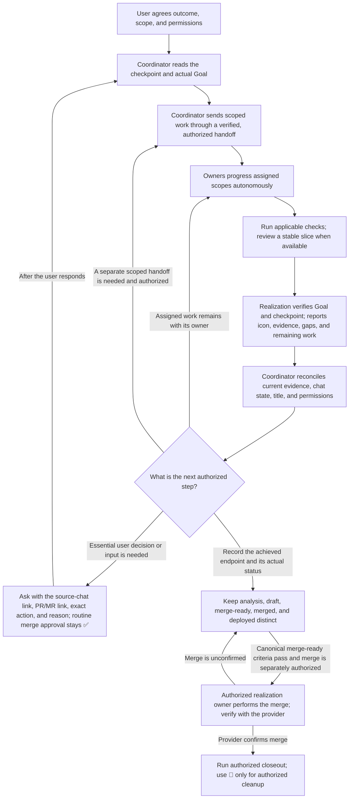

# Development coordinator

The development coordinator keeps one approved multi-chat effort aligned. The central chat uses the initiative's designated record and reconciles evidence; the record's owner maintains it. Realization chats own the work assigned to them. Use this role only when the user explicitly invokes it.

## How work moves

This is a conceptual overview, not an authorization or status state machine. Owners act within their assigned scope without routine coordinator start approval. The [canonical coordination reference](../plugins/ant/skills/development-coordinator/references/coordination.md) defines native handoff and readback steps, permission boundaries, status precedence, evidence gates, and closeout rules.

Analysis produces evidence and a recommendation; it does not authorize implementation. Proceed within the scope already approved by the user without routine start approvals. Coordinate only actual shared-resource contention or dependencies, and keep checkpoint updates to substantive decisions, dependencies, evidence, results, and next actions. Do not impose an artificial limit on concurrent workstreams or add preventive resource forecasts. Every new realization chat is explicitly told to use [development-executor](../plugins/ant/skills/development-executor/SKILL.md) and the other skills its scope needs, such as [implementation-orchestrator](../plugins/ant/skills/implementation-orchestrator/SKILL.md) for approved implementation; PR/MR delivery stays with that chat using [merge-request](../plugins/ant/skills/merge-request/SKILL.md).

## Optional per-initiative team profile

This user-specific example applies only to an initiative whose existing checkpoint records the user's selection under “Decisions and authority.” The coordinator carries it in the handoff; the receiving realization chat applies it only to newly dispatched role routes, ahead of adapter defaults for those routes. Work the coordinator or root realization chat performs itself stays on that chat's actual host model and outside the profile. The profile does not change other routes or global adapter defaults. If the route or its scope is unclear, ask the user; unsupported routes stay pending and are never silently replaced.

| Work | Model and effort |
|---|---|
| Bounded helper, investigation, validation, or narrow delegation | GPT-6.1 Terra / High |
| Dedicated browser verification | GPT-6.1 Terra / High |
| Deep research perspectives | GPT-6.1 Sol / High and Claude Opus / High; no Luna deep-research route |
| Implementation | Claude Opus / High |
| Independent implementation review | GPT-6.1 Sol / High when its provider is opposite the verified implementer's provider |

The realization owner dispatches browser verification as a separate Terra route against the current candidate and its actual user-facing flows, using an assistant-owned Codex browser only. Confirm the browser session is assistant-owned before use; if that cannot be verified, report a qualification gap. Terra reports reproducible findings and evidence to the realization owner; Opus makes authorized fixes and Terra retests the affected flows on the changed candidate. Sol separately reviews code and evidence; it is not the browser operator. Record the candidate SHA, URL, scenarios, results, limitations, actual test-agent model/effort, and the app provider under test as distinct facts. If the browser or route is unavailable, report a qualification gap. Do not use personal browser tabs, duplicate a running test, or infer new credential, spend, production, merge, or deployment authority.

The independent implementation review is a separate Sol route dispatched by the realization chat; a reviewer nested under Opus implementation does not qualify. The 🔎 status means analysis is active; it is not a model assignment. The dispatching realization chat distinguishes bounded work from deep research, asking the user if unclear. Deep research stays incomplete until both Sol and Opus contribute with verified model identity and effort. If either route is unavailable or provenance is unverified, report partial work and leave research incomplete unless the user explicitly accepts a partial result; record that choice. Other unsupported routes remain pending until the user explicitly chooses an alternative. For each selected route, report actual model and effort or mark them unverified. Record the exact host-reported Opus version; any Claude Opus version matches this profile unless the user pins one.

Use the [handoff capsule and routing safeguards](../plugins/ant/skills/development-coordinator/references/coordination.md#optional-per-initiative-team-profile) for host-availability checks, provider independence, and unsupported-route handling. If Sol is not opposite-provider to the verified implementer, report the independence gap and wait for the user's explicit choice. Existing running work and historical review evidence keep their actual model identity; a preference for future dispatch does not restart either or invalidate a review that remains valid.

## Reports and decisions

On start and continuation, each realization chat checks its actual Goal and checkpoint under the host's canonical lifecycle. It reports the verified endpoint, its own status icon when authorized, evidence, and remaining work to the coordinator. A completed Goal does not end an effort that still has feasible authorized work. Do not duplicate a canceled Goal, claim an unsupported resume, invent a blocker, or repeat an unanswered question outside an agreed reminder interval.

The coordinator reconciles a report against current evidence and the shared record. A report triggers verification; it does not grant authority or prove readiness by itself. Ask only for a decision or input that is actually needed, with links to the source chat and relevant PR/MR, the exact operation, and why it is needed.

Status reports use a [Czech five-column table](../plugins/ant/skills/development-coordinator/references/coordination.md#status-reports). Push notifications use only a [route the user explicitly approved](../plugins/ant/skills/development-coordinator/references/coordination.md#important-notifications); this plugin grants no endpoint or secret.

## Monitoring, verification, and finish

The coordinator discovers current scope from actual chats and their latest human assignments, including idle chats with remaining work. See [Discovery and ownership](../plugins/ant/skills/development-coordinator/references/coordination.md#discovery-and-ownership).

Recurring monitoring runs only if the user explicitly authorizes it. The check interval (for example 15 minutes) and the reminder interval for one unanswered decision (for example 4 hours) are separate, and unchanged states stay silent. Set a monitor up from the [periodic monitor template](../plugins/ant/skills/development-coordinator/references/periodic-monitor-template.md); [Authorized monitoring](../plugins/ant/skills/development-coordinator/references/coordination.md#authorized-monitoring) owns the rules, including CI observation.

An application change reaches Ready only after [final functional verification](../plugins/ant/skills/development-coordinator/references/coordination.md#final-functional-verification) of the whole changed flow in the repository's standard development app, such as `make dev` where documented.

A Ready chat stays open for the user's personal review. Once the user has adopted the finish workflow, telling that chat “OK, finish this chat” after review carries [the merge, task, owned-cleanup, and archive-last package](../plugins/ant/skills/development-coordinator/references/coordination.md#personal-review-and-finish). Deployment stays separate.

If the user adopts the workflow with a Goal for each realization, [that requirement](../plugins/ant/skills/development-coordinator/references/coordination.md#goals-in-an-adopted-workflow) applies; otherwise Goals stay optional.

## Titles, status, and closeout

When the initiative checkpoint records the user's chosen category vocabulary and authority to apply prefixes, every participating chat, including the central coordinator and tracked realization chats, carries a bracketed category prefix after its status icon if one is active. The coordinator assigns, applies, and corrects those categories within the recorded bounds; execution chats keep their assigned category. Use `[GENERAL]` for cross-module work, `[CI]` for tests/pipelines, `[RELEASE]` for release coordination, and the owning module for product work; Sentry work may use `[SENTRY][MODULE]`. These examples are configurable for other teams. Category and status prefixes preserve the semantic base title. Execution chats do not rewrite that base; the central coordinator proposes any base-title change and gets the user's approval. The [canonical title and icon glossary](../plugins/ant/skills/development-coordinator/references/coordination.md#chat-titles-and-status-icons) defines category selection, state meanings, precedence, and terminal behavior.

Realization chats own ordinary updates to their leading status icon; the coordinator checks relevant reports and corrects a stale icon only under the same user-granted authority. Icons show the semantic phase, not whether a task is idle or a sub-operation is running. ✅ means the current candidate is merge-ready, not merged or deployed; it stays ✅ when only routine merge approval remains. Report preview availability separately. 🕒 means a prepared CI candidate is waiting for a runner or admission, and 🧪 means tests, CI, browser verification, or review are actually running; neither alone is a blocker. ⏳ means an essential user decision/input is needed; 💤 means the user explicitly deferred the whole scope.

After provider-confirmed merge, any cleanup still needs its own authority, such as an invoked finish package. 🧹 describes that authorized cleanup phase when status-label management is authorized; it grants no cleanup, task-write, merge, or archive permission. Update a task only with verified mapping and write authority, and archive only a specifically requested target. Report incomplete closeout accurately; do not imply deployment without runtime evidence.

Every new task, including an analysis task, needs an explicit request. For Asana, section placement and the `ANT Prio` custom field are separate. A section such as `Vývoj AAA` never implies `ANT Prio = AAA`; set or remove that field only on the user's explicit instruction, and only for the named tasks. Read the field back separately from section placement. See the [canonical Asana task rules](../plugins/ant/skills/development-coordinator/references/coordination.md#optional-project-task).
