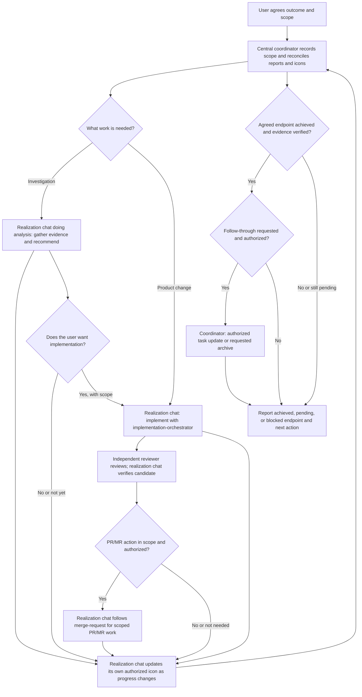

# Development coordinator

The development coordinator is an explicitly invoked role for one central chat that keeps an approved multi-chat effort coherent. It maintains the shared checkpoint, gives each workstream a clear owner, and brings verified results back to the user. It does not become the implementation or delivery owner.

## How the work moves

The user sets the outcome, scope, and permissions. The central coordinator assigns only approved chats, keeps the checkpoint current, and reconciles each report against evidence. An analysis chat is a realization chat doing analysis: it investigates and reports, and does not silently turn a recommendation into implementation authority. If implementation is chosen, a realization chat owns the implementation plan, source changes, review, and candidate checks. When PR/MR delivery is in scope and authorized, that realization chat follows `merge-request`; the central coordinator reconciles the resulting evidence and endpoint.

## Evidence and decisions

Keep verified facts, hypotheses, unknowns, and user decisions distinct. A report is an input to reconcile, not proof of more authority. A green historical check, a running CI job, or a teammate's claim cannot establish the current candidate's readiness. Preserve the distinctions between implemented, reviewed, merge-ready, merged, released, and deployed. The coordinator does not perform realization-chat PR/MR delivery, and delivery, merge, release, and deployment actions each require their applicable user authority. Ask the user only for a decision or permission that is actually missing; continue independent authorized work while that decision is pending.

## Titles, status, and closeout

Propose a clear base title for the actual effort and get approval before first setting or changing it. When the user's authorization covers status-label management, each tracked realization chat updates its own leading icon from verified progress; the coordinator checks it while reconciling relevant reports and corrects a forgotten or stale label as a fallback under that same authorization. Waiting for the user's discussion or implementation decision is ⏳; 💤 means explicit deferral of the chat's whole scope. A draft or implementation-only endpoint awaiting the user's next decision is ⏳ and is not merge-ready. See the [canonical icon glossary and title rules](../plugins/ant/skills/development-coordinator/references/coordination.md#chat-titles-and-status-icons) for endpoint, terminal, and precedence behavior.

At closeout, report what the agreed endpoint achieved, what remains pending or blocked, the evidence and limits, and the next action already authorized. Update an agreed task only when its scope and write authority cover that action; archive only a specifically requested target after verifying it is in scope and, where relevant, merged. Neither action implies deployment. Do not describe routine merge approval as a blocker, or a merge-ready result as merged or deployed.
