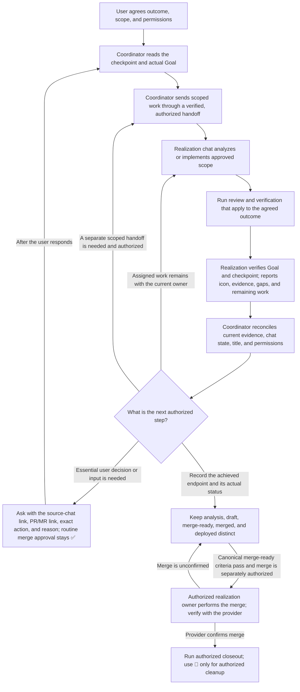

# Development coordinator

The development coordinator keeps one approved multi-chat effort aligned. The central chat uses the initiative's designated record and reconciles evidence; the record's owner maintains it. Realization chats own the work assigned to them. Use this role only when the user explicitly invokes it.

## How work moves

This is a conceptual overview, not an authorization or status state machine. The [canonical coordination reference](../plugins/ant/skills/development-coordinator/references/coordination.md) defines native handoff and readback steps, permission boundaries, status precedence, evidence gates, and closeout rules.

Analysis produces evidence and a recommendation; it does not authorize implementation. Start implementation only within user-approved scope, using [implementation-orchestrator](../plugins/ant/skills/implementation-orchestrator/SKILL.md). PR/MR delivery stays with the realization chat using [merge-request](../plugins/ant/skills/merge-request/SKILL.md).

## Reports and decisions

On start and continuation, each realization chat checks its actual Goal and checkpoint under the host's canonical lifecycle. It reports the verified endpoint, its own status icon when authorized, evidence, and remaining work to the coordinator. A completed Goal does not end an effort that still has feasible authorized work. Do not duplicate a canceled Goal, claim an unsupported resume, invent a blocker, or keep repeating an unanswered question.

The coordinator reconciles a report against current evidence and the shared record. A report triggers verification; it does not grant authority or prove readiness by itself. Ask only for a decision or input that is actually needed, with links to the source chat and relevant PR/MR, the exact operation, and why it is needed.

## Titles, status, and closeout

Get approval before applying or changing a chat's semantic base title. Realization chats own ordinary updates to their leading status icon; the coordinator checks relevant reports and corrects a stale icon only under the same user-granted authority. Icons show the semantic phase, not whether a task is idle or a sub-operation is running. ✅ means the current candidate is merge-ready, not merged or deployed; it stays ✅ when only routine merge approval remains. Report preview availability separately. ⏳ means an essential user decision/input is needed; 💤 means the user explicitly deferred the whole scope. The [canonical title and icon glossary](../plugins/ant/skills/development-coordinator/references/coordination.md#chat-titles-and-status-icons) defines state meanings, precedence, and terminal behavior.

After provider-confirmed merge, any cleanup still needs its own authority. 🧹 describes that authorized cleanup phase when status-label management is authorized; it grants no cleanup, task-write, merge, or archive permission. Update a task only with verified mapping and write authority, and archive only a specifically requested target. Report incomplete closeout accurately; do not imply deployment without runtime evidence.
